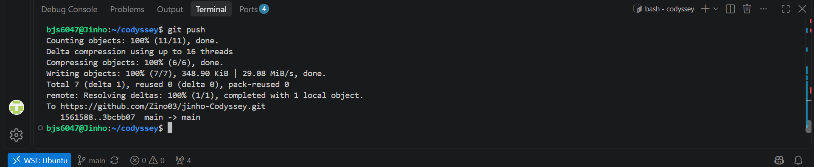
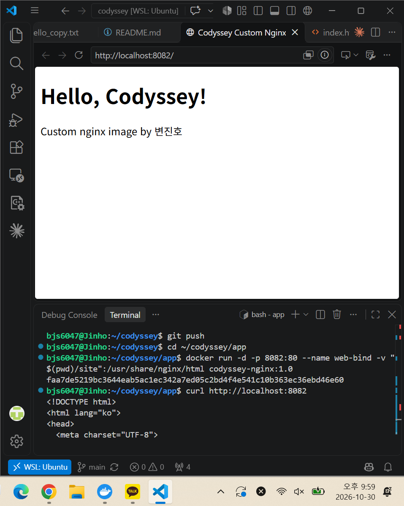
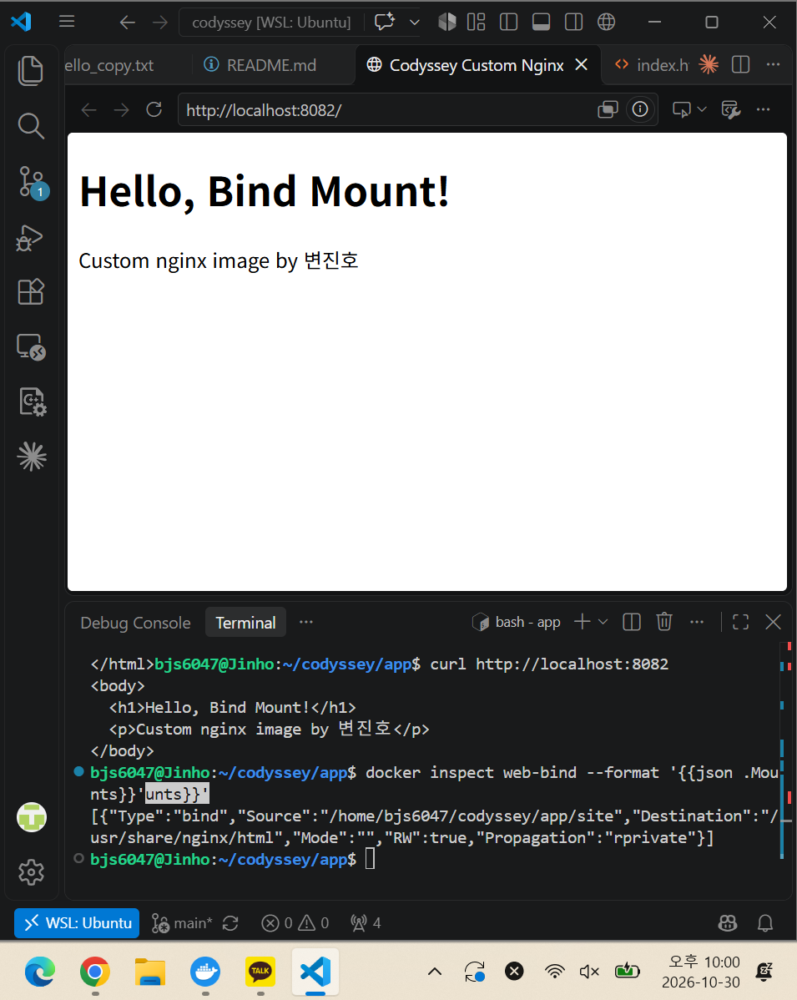

# Codyssey: 개발 워크스테이션 구축

저장소: https://github.com/Zino03/jinho-Codyssey

## 1. 프로젝트 개요

터미널(리눅스 CLI), Docker, Git/GitHub를 직접 설정하고 사용해 보며, 누구나 같은 방식으로 실행할 수 있는 개발 워크스테이션을 구축하는 미션입니다.

터미널로 작업 디렉토리와 권한을 정리하고, Docker를 설치 및 점검한 뒤 컨테이너를 실행/중지/관리했습니다. 이어서 Dockerfile로 웹 서버 이미지를 만들어 포트 매핑으로 접속하고, 바인드 마운트와 볼륨으로 "변경 반영"과 "데이터 영속성"을 검증했습니다. 모든 작업은 CLI 기반으로 수행했고, 명령과 출력 결과를 이 문서에 기록했습니다.

## 2. 실행 환경

| 항목 | 내용 |
|---|---|
| OS | Windows 10 + WSL2 Ubuntu |
| Shell / 터미널 | bash / VSCode 통합 터미널 (WSL 연결) |
| Docker | Docker Desktop (WSL2 백엔드), Docker version 29.7.2 |
| Git | git version 2.43.0 |

**환경 관련 참고 (개인 PC 종속 사항)**

- 작업 폴더는 WSL 리눅스 파일시스템(`/home/bjs6047/codyssey`)에 두었습니다. `/mnt/c` 같은 Windows 드라이브 경로에서는 `chmod` 권한 변경이 정상 반영되지 않을 수 있어 피했습니다.
- 사용자명(`bjs6047`), 경로, 포트(8080/8081/8082)는 개인 환경 값이므로 다른 환경에서는 달라질 수 있습니다.

## 3. 저장소 구조

```
codyssey/
├── README.md              기술 문서
├── practice/              터미널/권한 실습용 폴더
├── app/
│   ├── Dockerfile         커스텀 nginx 이미지
│   └── site/index.html    웹 서버에 띄울 페이지
└── docs/images/           스크린샷
```

## 4. 수행 체크리스트

각 항목의 검증 명령과 결과는 링크된 섹션에서 확인할 수 있습니다.

- [x] 터미널 기본 조작 → [5-1](#5-1-터미널-기본-조작)
- [x] 권한 변경 실습 → [5-2](#5-2-권한-실습)
- [x] Docker 설치/점검 → [5-4](#5-4-docker-설치-및-점검)
- [x] Docker 기본 운영 명령 (images, ps, logs, stats, stop/start) → [5-5](#5-5-docker-기본-운영-명령), [5-6](#5-6-컨테이너-실행-실습), [5-7](#5-7-커스텀-이미지-및-포트-매핑)
- [x] hello-world 실행 → [5-6](#5-6-컨테이너-실행-실습)
- [x] ubuntu 컨테이너 실행, attach/exec 차이 관찰 → [5-6](#5-6-컨테이너-실행-실습)
- [x] Dockerfile 커스텀 이미지 빌드/실행 → [5-7](#5-7-커스텀-이미지-및-포트-매핑)
- [x] 포트 매핑 접속 (2회) → [5-7](#5-7-커스텀-이미지-및-포트-매핑)
- [x] 바인드 마운트 반영 → [5-8](#5-8-바인드-마운트)
- [x] 볼륨 영속성 → [5-9](#5-9-docker-볼륨-영속성)
- [x] Git 설정 → [5-3](#5-3-git-설정-및-github-연동)
- [x] VSCode GitHub 로그인 및 저장소 연동 → [5-3](#5-3-git-설정-및-github-연동)

## 5. 수행 로그 및 검증

모든 로그는 핵심 부분만 발췌했고, 생략한 부분은 `(중략)`으로 표시했습니다.

## 5-1. 터미널 기본 조작

현재 위치/숨김 파일 포함 목록 확인, 디렉토리 생성 및 이동, 빈 파일 생성, 내용 쓰기와 확인을 수행했습니다.

### (1) 위치 확인과 목록
```bash
bjs6047@Jinho:~/codyssey$ pwd
/home/bjs6047/codyssey
```
- `pwd` : 지금 내가 있는 폴더의 **절대 경로**를 출력

```bash
bjs6047@Jinho:~/codyssey$ ls -la
total 12
drwxr-xr-x 3 bjs6047 bjs6047 4096 Oct 30 19:57 .
drwxr-x--- 8 bjs6047 bjs6047 4096 Oct 30 19:58 ..
drwxr-xr-x 7 bjs6047 bjs6047 4096 Oct 30 19:57 .git
```
- `ls`: 폴더 안 목록 보기 (`-l`: 자세히, `-a`: 숨김 파일)
- `total`: 사용 중인 디스크 블록 합계
- `drwxr-xr-x`: 구조 (`d` / `rwx` / `r-x` / `r-x`)
  1. 파일 종류: d(디렉토리), -(일반 파일), l(심볼릭 링크)
  2. 권한 종류: r(읽기), w(쓰기 - 수정 및 생성), x(실행, 접근), -(해당 권한 없음)
  => 순차적으로 소유자 / 그룹 / 기타 사용자의 권한
- `3`: 하드링크의 수, 디렉토리는 하위 폴더 수에 따라 늘어남
- `bjs6047`: 소유자 / 그룹
- `4096`: 크기(byte), 디렉토리는 보통 4096
- `날짜`: 마지막 수정 시각
- `.`: 현재 폴더 자신 / `..`: 상위 폴더 / `.git`: git 저장소 정보

### (2) 디렉토리 생성 및 이동
```bash
bjs6047@Jinho:~/codyssey$ mkdir -p ~/codyssey/practice/docs
bjs6047@Jinho:~/codyssey$ cd ~/codyssey/practice
bjs6047@Jinho:~/codyssey/practice$ pwd
/home/bjs6047/codyssey/practice
```
- `mkdir`: 폴더 생성 (-p: 중간 경로가 없어도 다 만들어서 생성)
- `~`: 홈 폴더 (`/home/bjs6047`)
- `cd`: 폴더 이동 (change directory)

### (3) 빈 파일, 쓰기, 읽기
```bash
bjs6047@Jinho:~/codyssey/practice$ touch empty.txt
bjs6047@Jinho:~/codyssey/practice$ echo "hello codyssey" > hello.txt
bjs6047@Jinho:~/codyssey/practice$ ls -la
total 16
drwxr-xr-x 3 bjs6047 bjs6047 4096 Oct 30 20:31 .
drwxr-xr-x 4 bjs6047 bjs6047 4096 Oct 30 20:11 ..
drwxr-xr-x 2 bjs6047 bjs6047 4096 Oct 30 20:11 docs
-rw-r--r-- 1 bjs6047 bjs6047    0 Oct 30 20:30 empty.txt
-rw-r--r-- 1 bjs6047 bjs6047   15 Oct 30 20:31 hello.txt
bjs6047@Jinho:~/codyssey/practice$ cat hello.txt
hello codyssey
```
- `touch`: 빈 파일 생성 (이미 있으면 수정 시각만 갱신)
- `echo` : 글자를 출력 `>`는 그 출력을 화면 대신 파일에 저장 (덮어쓰기)
- `cat`: 파일 내용을 화면에 출력

### (4) >, >>
`>`와 `>>`의 차이를 확인했습니다. `>`는 기존 내용을 덮어쓰고, `>>`는 파일 끝에 추가합니다.

```bash
bjs6047@Jinho:~/codyssey/practice$ echo "second line" > hello.txt
bjs6047@Jinho:~/codyssey/practice$ cat hello.txt
second line
bjs6047@Jinho:~/codyssey/practice$ echo "third line" >> hello.txt
bjs6047@Jinho:~/codyssey/practice$ cat hello.txt
second line
third line
```
- `>`: 기존 내용 삭제 후 새로 씀 / `>>`: 파일 끝에 추가


### (5) 복사, 이동, 이름 변경
복사, 이동, 이름 변경을 확인했습니다. 같은 `mv` 명령이라도 마지막 인자가 기존 디렉토리면 해당 디렉토리로 이동하고, 존재하지 않는 이름이면 이름 변경으로 동작합니다.

```bash
bjs6047@Jinho:~/codyssey/practice$ cp hello.txt hello_copy.txt
bjs6047@Jinho:~/codyssey/practice$ ls -l
-rw-r--r-- 1 bjs6047 bjs6047    0 Oct 30 20:30 empty.txt
-rw-r--r-- 1 bjs6047 bjs6047   23 Oct 30 20:32 hello.txt
-rw-r--r-- 1 bjs6047 bjs6047   23 Oct 30 20:35 hello_copy.txt
(중략)
bjs6047@Jinho:~/codyssey/practice$ mv hello_copy.txt docs/
bjs6047@Jinho:~/codyssey/practice$ mv empty.txt blank.txt
bjs6047@Jinho:~/codyssey/practice$ ls -l
-rw-r--r-- 1 bjs6047 bjs6047    0 Oct 30 20:30 blank.txt
drwxr-xr-x 2 bjs6047 bjs6047 4096 Oct 30 20:36 docs
-rw-r--r-- 1 bjs6047 bjs6047   23 Oct 30 20:32 hello.txt
bjs6047@Jinho:~/codyssey/practice$ ls -l docs
-rw-r--r-- 1 bjs6047 bjs6047 23 Oct 30 20:35 hello_copy.txt
```
- `cp 원본 사본`: 복사
- `mv A B`: B가 **존재하는 폴더**면 그 안으로 이동, 없는 이름이면 이름 변경
  -> `mv hello_copy.txt docs/`: docs 폴더로 이동
  -> `mv empty.txt blank.txt`: empty가 blank로 이름 변경


### (6) 상대 경로 이동과 삭제
상대 경로 이동과 삭제를 확인했습니다. 디렉토리는 `-r` 옵션이 필요합니다.

```bash
bjs6047@Jinho:~/codyssey/practice$ cd docs
bjs6047@Jinho:~/codyssey/practice/docs$ pwd
/home/bjs6047/codyssey/practice/docs
bjs6047@Jinho:~/codyssey/practice/docs$ cd ..
bjs6047@Jinho:~/codyssey/practice$ pwd
/home/bjs6047/codyssey/practice
bjs6047@Jinho:~/codyssey/practice$ rm blank.txt
bjs6047@Jinho:~/codyssey/practice$ rm -r docs
bjs6047@Jinho:~/codyssey/practice$ ls -la
total 12
drwxr-xr-x 2 bjs6047 bjs6047 4096 Oct 30 20:42 .
drwxr-xr-x 4 bjs6047 bjs6047 4096 Oct 30 20:11 ..
-rw-r--r-- 1 bjs6047 bjs6047   23 Oct 30 20:32 hello.txt
```
- 상대 경로는 `/`, `~`가 아닌 현재 위치에서 출발
- `rm`은 휴지통 없이 바로 삭제됨 (`-r`: 하위 내용까지 재귀적으로 삭제)


## 5-2. 권한 실습

파일(`hello.txt`)과 디렉토리(`permdir`) 각각에 `chmod`를 적용해 변경 전/후를 비교했습니다.

```bash
# 파일: 644 -> 600 -> 644
bjs6047@Jinho:~/codyssey/practice$ ls -l hello.txt
-rw-r--r-- 1 bjs6047 bjs6047 23 Oct 30 20:32 hello.txt
bjs6047@Jinho:~/codyssey/practice$ chmod 600 hello.txt
bjs6047@Jinho:~/codyssey/practice$ ls -l hello.txt
-rw------- 1 bjs6047 bjs6047 23 Oct 30 20:32 hello.txt
bjs6047@Jinho:~/codyssey/practice$ chmod 644 hello.txt
bjs6047@Jinho:~/codyssey/practice$ ls -l hello.txt
-rw-r--r-- 1 bjs6047 bjs6047 23 Oct 30 20:32 hello.txt

# 디렉토리: 755 -> 600 -> 755
bjs6047@Jinho:~/codyssey/practice$ mkdir permdir
bjs6047@Jinho:~/codyssey/practice$ ls -ld permdir
drwxr-xr-x 2 bjs6047 bjs6047 4096 Oct 30 20:48 permdir
bjs6047@Jinho:~/codyssey/practice$ chmod 600 permdir
bjs6047@Jinho:~/codyssey/practice$ ls -ld permdir
drw------- 2 bjs6047 bjs6047 4096 Oct 30 20:48 permdir
bjs6047@Jinho:~/codyssey/practice$ cd permdir
bash: cd: permdir: Permission denied
bjs6047@Jinho:~/codyssey/practice$ chmod 755 permdir
bjs6047@Jinho:~/codyssey/practice$ ls -ld permdir
drwxr-xr-x 2 bjs6047 bjs6047 4096 Oct 30 20:48 permdir
bjs6047@Jinho:~/codyssey/practice$ cd permdir
bjs6047@Jinho:~/codyssey/practice/permdir$ pwd
/home/bjs6047/codyssey/practice/permdir
```
- `chmod 숫자 대상`: 권한 변경. 숫자 3자리 = 소유자/그룹/기타
  -> 각 자리 = r(4) + w(2) + x(1)의 합으로 표현

소유자에게 `r`, `w`가 있는데도 디렉토리의 `x`가 없으면 `cd`가 실패했습니다. 디렉토리의 `x`는 "그 안으로 들어가거나 안의 항목에 접근할 수 있는 권한"을 뜻합니다. 실험 후 `permdir`는 삭제했습니다.

## 5-3. Git 설정 및 GitHub 연동

기본 브랜치를 `main`으로 설정하고 사용자 정보를 등록했습니다.

```bash
bjs6047@Jinho:~/codyssey$ git config --global init.defaultBranch main
bjs6047@Jinho:~/codyssey$ git branch -m main
```
- `git init`: 현재 폴더를 깃 저장소로 만듦
- `git config --global init.defaultBranch main`: `git init` 할 때 기본 브랜치 이름을 `main`으로 설정
- `git branch -m main`: 이미 만든 이 저장소의 브랜치를 `main`으로 이름 변경

```bash
# 커밋에 기록될 작성자 이름/이메일
bjs6047@Jinho:~/codyssey$ git config --global user.name "Zino03"
bjs6047@Jinho:~/codyssey$ git config --global user.email "z***@naver.com"
```
```bash
# 현재 적용된 설정 전체 출력
bjs6047@Jinho:~/codyssey$ git config --list
user.name=Zino03
user.email=z***@naver.com
init.defaultbranch=main
core.repositoryformatversion=0
core.filemode=true
core.bare=false
core.logallrefupdates=true
```
- `core.repositoryformatversion=0`: 저장소 내부 형식의 버전
- `core.filemode=true`: 파일 실행 권한 변경을 git이 변경으로 인식 (Linux file system)
- `core.bare=false`: 작업 폴더가 있는 일반 저장소 (true면 파일 없이 이력만 있는 서버용 저장소)
- `core.logallrefupdates=true`: 브랜치가 기록을 남김

```bash
bjs6047@Jinho:~/codyssey$ gh auth status
github.com
  ✓ Logged in to github.com account Zino03 (/home/bjs6047/.config/gh/hosts.yml)
  - Active account: true
  - Git operations protocol: https
  - Token: [masked]
```

VSCode(WSL 연결 상태)에서 GitHub 로그인 및 저장소 연동을 완료했습니다.
GitHub 인증 상태입니다. 토큰은 마스킹되어 표시됩니다.



## 5-4. Docker 설치 및 점검

```bash
bjs6047@Jinho:~/codyssey$ docker --version
Docker version 29.7.2, build a7dcaa6
bjs6047@Jinho:~/codyssey$ docker info
Client:
 Version:    29.7.2
 Context:    default
 (플러그인 목록 중략)

Server:
 Containers: 2
  Running: 0
  Paused: 0
  Stopped: 2
 Images: 1
 Server Version: 29.7.2
 Storage Driver: overlayfs
 Logging Driver: json-file
 Cgroup Driver: cgroupfs
 Cgroup Version: 2
 Kernel Version: 6.6.87.2-microsoft-standard-WSL2
 Operating System: Docker Desktop
 OSType: linux
 Architecture: x86_64
 CPUs: 16
 Total Memory: 7.608GiB
 (이하 중략)
```
- `docker info`: Docker 엔진의 상태 (Server 항목이 나오면 통신 성공)
- `Client`: `docker` 명령 쪽 정보 / `Server`: 실제로 컨테이너를 돌리는 엔진 쪽
- `Containers/Images`: 지금 존재하는 컨테이너 수와 이미지 수
- `Server Version: 29.7.2`: 클라이언트와 같은 버전
- `Storage Driver: overlayfs`: 이미지를 레이어로 겹쳐 저장하는 방식
- `Cgroup Driver/Version`: 컨테이너 자원(CPU, 메모리)을 제한·관리하는 리눅스 기능
- `Kernel Version: ...microsoft-standard-WSL2`: WSL2 위에서 돌고 있다는 증거
- `Operating System: Docker Desktop`, `OSType: linux`: 리눅스 컨테이너를 Docker Desktop이 제공
- `CPUs`, `Total Memory`: 엔진이 쓸 수 있는 자원

클라이언트와 서버 버전이 같고, 커널이 `microsoft-standard-WSL2`로 표시되어 WSL2 백엔드로 동작함을 확인했습니다. 서버 정보에 보이는 기존 컨테이너 2개와 이미지 1개(mysql:8.4)는 다른 프로젝트에서 만든 것입니다.

## 5-5. Docker 기본 운영 명령

```bash
bjs6047@Jinho:~/codyssey$ docker pull nginx:alpine
alpine: Pulling from library/nginx
(레이어 다운로드 중략)
Status: Downloaded newer image for nginx:alpine
docker.io/library/nginx:alpine
```
- `pull`: 레지스트리(Docker Hub)에서 이미지를 내려받음
- `nginx:alpine`: `이름:태그`. nginx는 웹 서버, alpine은 가벼운 리눅스 기반 버전

```bash
# 내려받은 이미지 (U는 컨테이너가 쓰고 있다는 표시)
bjs6047@Jinho:~/codyssey$ docker images
IMAGE          ID             DISK USAGE   CONTENT SIZE   EXTRA
mysql:8.4      b3b90af2a655       1.12GB          255MB    U
nginx:alpine   785835ea65db       94.5MB         27.2MB
```
```bash
bjs6047@Jinho:~/codyssey$ docker ps -a
CONTAINER ID   IMAGE       COMMAND                  CREATED        STATUS                    PORTS     NAMES
f6dde900b527   mysql:8.4   "docker-entrypoint.s…"   2 months ago   Exited (137) 2 months ago           ieobom-mysql
afa82ca3616a   mysql:8.4   "docker-entrypoint.s…"   2 months ago   Exited (0) 2 months ago             ieobom-mysql-check
```
- `ps`: 실행 중인 컨테이너만 / `-a`: 종료된 것까지 전부
- `Exited (0)`: 정상 종료 / `Exited (137)`: 강제 종료(KILL 신호 등)
```bash
bjs6047@Jinho:~/codyssey$ docker stats --no-stream
(실행 중인 컨테이너가 없어 출력 없음)
```
- `stats`: 컨테이너의 CPU/메모리 사용량 
- `--no-stream`: 계속 갱신하지 않고 한 번만 출력

실행 중인 컨테이너가 없어 `docker stats`와 `docker logs`는 컨테이너를 실행한 뒤 5-6, 5-7에서 기록했습니다.

## 5-6. 컨테이너 실행 실습

### (1) hello-world
로컬에 이미지가 없으면 `docker run`이 자동으로 pull한 뒤 실행합니다.

```bash
bjs6047@Jinho:~/codyssey$ docker run hello-world
Unable to find image 'hello-world:latest' locally
latest: Pulling from library/hello-world
Status: Downloaded newer image for hello-world:latest

Hello from Docker!
This message shows that your installation appears to be working correctly.
(이하 중략)
```
- `run`: 이미지로 컨테이너를 만들고 실행. 이미지가 없으면 **자동으로 pull**
- `latest`: 태그를 안 주면 붙는 기본 태그
- `Hello from Docker!`: 설치가 정상이라는 메시지. 이 컨테이너는 메시지를 출력하고 끝나므로 곧바로 종료
```bash
bjs6047@Jinho:~/codyssey$ docker ps -a
CONTAINER ID   IMAGE         COMMAND                  CREATED         STATUS                      PORTS     NAMES
6f9769bf5e1b   hello-world   "/hello"                 4 seconds ago   Exited (0) 4 seconds ago              romantic_lumiere
```
- `"/hello"`: 컨테이너가 실행한 프로그램
- `Exited (0)`: 할 일을 끝내고 정상 종료
- `romantic_lumiere`: `--name`을 안 주면 Docker가 무작위로 지어준 이름

hello-world 컨테이너는 메시지를 출력하고 프로세스(`/hello`)가 끝나 `Exited (0)`으로 종료됩니다.

### (2) ubuntu 컨테이너 진입

```bash
bjs6047@Jinho:~/codyssey$ docker run -it --name ubuntu-test ubuntu bash
```
- `-i` 입력 유지 + `-t` 터미널 할당 = `-it`: 컨테이너 안에서 대화형으로 작업
- `--name ubuntu-test`: 컨테이너 이름 지정
- `ubuntu`: 사용할 이미지 / `bash`: 컨테이너가 실행할 프로그램(= PID 1)

```bash
root@15a0440ff73d:/# ls
bin   dev  home  lib64  mnt  proc  run   srv  tmp  var
boot  etc  lib   media  opt  root  sbin  sys  usr
root@15a0440ff73d:/# echo "hello from container"
hello from container
root@15a0440ff73d:/# cat /etc/os-release
PRETTY_NAME="Ubuntu 26.04.1 LTS"
(중략)
root@15a0440ff73d:/# exit
```
- 프롬프트가 `root@컨테이너ID`로 바뀜 = 이제 컨테이너 안. `/`는 컨테이너의 루트 폴더
- `ls` 출력(bin, etc, usr...)은 리눅스 기본 폴더 구조

```bash
bjs6047@Jinho:~/codyssey$ docker ps
CONTAINER ID   IMAGE     COMMAND   CREATED   STATUS    PORTS     NAMES
bjs6047@Jinho:~/codyssey$ docker ps -a
CONTAINER ID   IMAGE         COMMAND                  CREATED              STATUS                      PORTS     NAMES
15a0440ff73d   ubuntu        "bash"                   About a minute ago   Exited (0) 11 seconds ago             ubuntu-test
(이하 생략)
```

컨테이너 안은 호스트(WSL Ubuntu)와 별개의 Ubuntu 26.04 환경이었습니다. `exit` 후 `docker ps`에는 보이지 않고 `docker ps -a`에만 남았습니다.

### (3) exec 비교, logs, stats

```bash
bjs6047@Jinho:~/codyssey$ docker run -d --name ubuntu-bg ubuntu sleep infinity
3a07402adf3ea9804ec4da1f0c02506c6f37542cd791c06ec3f01bd772d57a38
bjs6047@Jinho:~/codyssey$ docker ps
CONTAINER ID   IMAGE     COMMAND            CREATED         STATUS         PORTS     NAMES
3a07402adf3e   ubuntu    "sleep infinity"   4 seconds ago   Up 3 seconds             ubuntu-bg
```
- `-d`: 백그라운드(detached) 실행 
- `sleep infinity`: 무한 대기하는 프로그램(= PID 1). 컨테이너가 계속 살아 있게 함
- 출력의 긴 문자열: 컨테이너 전체 ID

```bash
bjs6047@Jinho:~/codyssey$ docker exec -it ubuntu-bg bash
root@3a07402adf3e:/# echo "exec session"
exec session
root@3a07402adf3e:/# exit
bjs6047@Jinho:~/codyssey$ docker ps
CONTAINER ID   IMAGE     COMMAND            CREATED          STATUS          PORTS     NAMES
3a07402adf3e   ubuntu    "sleep infinity"   20 seconds ago   Up 19 seconds             ubuntu-bg
```
- `exec`: **이미 실행 중인** 컨테이너 안에서 추가 명령 실행. 여기서는 bash를 하나 더 띄움
- `exit`해도 이 bash는 **추가 프로세스**라서 PID 1(`sleep`)은 살아 있음 → 컨테이너 유지(`Up 19 seconds`)

```bash
bjs6047@Jinho:~/codyssey$ docker logs ubuntu-bg
(출력 없음)
bjs6047@Jinho:~/codyssey$ docker stats --no-stream
CONTAINER ID   NAME        CPU %     MEM USAGE / LIMIT     MEM %     NET I/O         BLOCK I/O       PIDS
3a07402adf3e   ubuntu-bg   0.00%     1.617MiB / 7.608GiB   0.02%     1.17kB / 126B   471kB / 4.1kB   1
```
- `logs`: 컨테이너 PID 1이 내보낸 출력(stdout/stderr) 확인
- `CPU %`: CPU 사용률 / `MEM USAGE / LIMIT`: 쓰는 메모리 / 한도(WSL2 가상머신 전체)
- `NET I/O`: 네트워크 송수신량 / `BLOCK I/O`: 디스크 읽기/쓰기량
- `PIDS 1`: 컨테이너 안 프로세스 1개(`sleep`만)

### (4) run -it와 exec -it의 차이 정리

| 방식 | 명령 | `exit` 후 | 이유 |
|---|---|---|---|
| run -it | `docker run -it ubuntu bash` | 컨테이너 종료 | 내가 연 bash가 PID 1이라 끝나면 컨테이너도 끝남 |
| exec -it | `docker exec -it ubuntu-bg bash` | 컨테이너 유지 | PID 1은 `sleep infinity`이고 bash는 추가 프로세스 |

컨테이너는 PID 1 프로세스가 살아 있는 동안만 실행됩니다. `docker logs ubuntu-bg`가 비어 있는 것은 PID 1(`sleep`)이 출력을 내지 않기 때문입니다. 출력이 있는 컨테이너의 로그는 5-7에서 확인했습니다.

## 5-7. 커스텀 이미지 및 포트 매핑

**선택한 방식**: (A) 웹 서버 베이스 이미지 활용. `nginx:alpine`을 베이스로 정적 페이지만 교체했습니다.

### (1) Dockerfile (`app/Dockerfile`)

```dockerfile
FROM nginx:alpine

LABEL org.opencontainers.image.title="codyssey-nginx" \
      org.opencontainers.image.authors="Zino03"

ENV APP_ENV=dev

COPY site/ /usr/share/nginx/html/

EXPOSE 80

HEALTHCHECK --interval=30s --timeout=3s --retries=3 \
  CMD wget -q --spider http://localhost/ || exit 1
```

### (2) 커스텀 포인트와 목적

| 명령 | 목적 |
|---|---|
| `FROM nginx:alpine` | 가볍고 검증된 웹 서버 이미지를 베이스로 사용 |
| `LABEL` | 이미지 제목/작성자를 메타데이터로 기록 |
| `ENV APP_ENV=dev` | 실행 환경을 코드와 분리해 환경 변수로 주입 |
| `COPY site/ ...` | 기본 nginx 페이지를 내 HTML로 교체 |
| `EXPOSE 80` | 컨테이너가 80번 포트를 사용함을 문서화 (실제 연결은 `-p`가 담당) |
| `HEALTHCHECK` | 서버가 실제로 응답하는지 주기적으로 점검 |
- `FROM`: 베이스 이미지 (이 이미지 위에 내 설정을 얹음)
- `LABEL`: 이미지에 붙이는 이름표 (메타데이터)
- `ENV`: 컨테이너 안에서 쓸 환경 변수 설정
- `COPY`: 빌드할 때 `site/` 폴더 내용을 이미지 안 html로 복사 -> 기본 페이지를 내 `index.html`로 교체
- `EXPOSE`: 포트 사용 선언
- `HEALTHCHECK`: 서버 자동 점검
  1. `--interval=30s` 30초마다
  2. `--timeout=3s` 3초 내 응답 없으면 실패
  3. `--retries=3` 3번 연속 실패 시 unhealthy

### (3) 빌드 및 실행

```bash
bjs6047@Jinho:~/codyssey/app$ docker build -t codyssey-nginx:1.0 .
[+] Building 0.7s (7/7) FINISHED                            docker:default
 (중략)
 => [2/2] COPY site/ /usr/share/nginx/html/                           0.0s
 (중략)
 => => naming to docker.io/library/codyssey-nginx:1.0                 0.0s
bjs6047@Jinho:~/codyssey/app$ docker images
IMAGE                ID             DISK USAGE   CONTENT SIZE   EXTRA
codyssey-nginx:1.0   5b4160378b32       93.6MB         26.3MB
hello-world:latest   c567b231f656       25.9kB         9.49kB
mysql:8.4            b3b90af2a655       1.12GB          255MB    U
nginx:alpine         785835ea65db       94.5MB         27.2MB
ubuntu:latest        6a06111c3b0a        163MB         45.9MB
```
- `build`: Dockerfile로 이미지 생성 / `-t 이름:태그`: 이미지 이름 지정 / 마지막 `.`: **빌드 컨텍스트**(= 현재 폴더).

```bash
bjs6047@Jinho:~/codyssey/app$ docker run -d -p 8080:80 --name web-8080 codyssey-nginx:1.0
f7d5da5414a062f72b7a4ee4222cb2b06be75a99b3e8e71f18321de08963fa81
bjs6047@Jinho:~/codyssey/app$ docker run -d -p 8081:80 --name web-8081 codyssey-nginx:1.0
d67bed3fb4d8820cfeb595755225b634b9c803117f293a035ff3b0705f510a89
bjs6047@Jinho:~/codyssey/app$ docker ps
CONTAINER ID   IMAGE                COMMAND                  CREATED          STATUS                             PORTS                                     NAMES
d67bed3fb4d8   codyssey-nginx:1.0   "/docker-entrypoint.…"   4 seconds ago    Up 3 seconds (health: starting)    0.0.0.0:8081->80/tcp, [::]:8081->80/tcp   web-8081
f7d5da5414a0   codyssey-nginx:1.0   "/docker-entrypoint.…"   14 seconds ago   Up 13 seconds (health: starting)   0.0.0.0:8080->80/tcp, [::]:8080->80/tcp   web-8080
```
- `-p 호스트포트:컨테이너포트`: 내 컴퓨터의 8080을 컨테이너의 80에 연결 (브라우저로 접속하기 위해)
  -> port 8081로 동일하게 수행하여 동시에 2개 운영

### (4) 접속 확인 (curl)

```bash
bjs6047@Jinho:~/codyssey/app$ curl http://localhost:8080
<!DOCTYPE html>
(중략)
  <h1>Hello, Codyssey!</h1>
  <p>Custom nginx image by 변진호</p>
(이하 생략)
bjs6047@Jinho:~/codyssey/app$ curl http://localhost:8081
(동일한 HTML 응답)
```
- `curl`: 터미널용 웹 요청 도구로 내 HTML이 돌아오면 포트 매핑 성공
- `localhost`: 내 컴퓨터

**포트 매핑 접속 증거**: 같은 이미지를 호스트 포트만 달리해 2회 실행했습니다 (`-p 8080:80`, `-p 8081:80`). 브라우저 주소창에 포트가 표시됩니다.


### (5) LABEL 반영 및 헬스체크 확인

```bash
bjs6047@Jinho:~/codyssey$ docker inspect codyssey-nginx:1.0 --format '{{json .Config.Labels}}'
{"maintainer":"NGINX Docker Maintainers <docker-maint@nginx.com>","org.opencontainers.image.authors":"Zino03","org.opencontainers.image.title":"codyssey-nginx"}
bjs6047@Jinho:~/codyssey$ docker ps
CONTAINER ID   IMAGE                COMMAND                  CREATED        STATUS                   PORTS                                     NAMES
d67bed3fb4d8   codyssey-nginx:1.0   "/docker-entrypoint.…"   3 minutes ago  Up 3 minutes (healthy)   0.0.0.0:8081->80/tcp, [::]:8081->80/tcp   web-8081
f7d5da5414a0   codyssey-nginx:1.0   "/docker-entrypoint.…"   3 minutes ago  Up 3 minutes (healthy)   0.0.0.0:8080->80/tcp, [::]:8080->80/tcp   web-8080
```
- `inspect`: 이미지/컨테이너의 상세 정보 (`--format`으로 원하는 항목만 추출)
- 넣은 LABEL 2개 + maintainer


내가 지정한 LABEL이 반영되었고, 베이스 이미지(nginx)의 `maintainer` 라벨은 상속되었습니다. 실행 직후 `health: starting`이던 상태가 `healthy`로 바뀌어 HEALTHCHECK가 동작함을 확인했습니다.

### (6) 컨테이너 로그, 환경 변수, 중지/재시작 확인

`web-8080`에 대해 로그 확인, `ENV` 반영 확인, 중지(`stop`)와 재시작(`start`)을 수행했습니다.

```bash
bjs6047@Jinho:~/codyssey$ docker logs web-8080
/docker-entrypoint.sh: /docker-entrypoint.d/ is not empty, will attempt to perform configuration
(중략)
/docker-entrypoint.sh: Configuration complete; ready for start up
2026/10/30 12:54:00 [notice] 1#1: nginx/1.31.8
(중략)
172.17.0.1 - - [30/Oct/2026:12:54:16 +0000] "GET / HTTP/1.1" 200 203 "-" "curl/8.5.0" "-"
(중략)
::1 - - [30/Oct/2026:12:54:30 +0000] "GET / HTTP/1.1" 200 203 "-" "Wget" "-"
::1 - - [30/Oct/2026:12:55:00 +0000] "GET / HTTP/1.1" 200 203 "-" "Wget" "-"
(이하 30초 간격의 Wget 요청 중략)
172.17.0.1 - - [30/Oct/2026:13:15:23 +0000] "GET / HTTP/1.1" 200 203 "-" "curl/8.5.0" "-"
```
- 접속 로그: 앞 주소는 요청자(도커 네트워크의 호스트), `GET /`는 메인 페이지 요청, `200`은 성공, `203`은 응답 크기(바이트), 끝은 요청한 프로그램(curl)

```bash
bjs6047@Jinho:~/codyssey$ docker exec web-8080 printenv APP_ENV
dev # Dockerfile의 `ENV` 반영
bjs6047@Jinho:~/codyssey$ docker stop web-8080 # 정상 종료 신호를 보내서 중지
web-8080
bjs6047@Jinho:~/codyssey$ docker ps # web-8080 사라짐
CONTAINER ID   IMAGE                COMMAND                  CREATED          STATUS                    PORTS                                     NAMES
d67bed3fb4d8   codyssey-nginx:1.0   "/docker-entrypoint.…"   21 minutes ago   Up 21 minutes (healthy)   0.0.0.0:8081->80/tcp, [::]:8081->80/tcp   web-8081
bjs6047@Jinho:~/codyssey$ docker ps -a --filter name=web-8080
CONTAINER ID   IMAGE                COMMAND                  CREATED          STATUS                      PORTS     NAMES
f7d5da5414a0   codyssey-nginx:1.0   "/docker-entrypoint.…"   21 minutes ago   Exited (0) 16 seconds ago             web-8080
bjs6047@Jinho:~/codyssey$ docker start web-8080 # 컨테이너 재시작 
web-8080
bjs6047@Jinho:~/codyssey$ docker ps # 다시 8080 올라옴
CONTAINER ID   IMAGE                COMMAND                  CREATED          STATUS                            PORTS                                     NAMES
d67bed3fb4d8   codyssey-nginx:1.0   "/docker-entrypoint.…"   21 minutes ago   Up 21 minutes (healthy)           0.0.0.0:8081->80/tcp, [::]:8081->80/tcp   web-8081
f7d5da5414a0   codyssey-nginx:1.0   "/docker-entrypoint.…"   22 minutes ago   Up 5 seconds (health: starting)   0.0.0.0:8080->80/tcp, [::]:8080->80/tcp   web-8080
```

검증 결과:

- `docker logs`에서 내가 보낸 `curl` 요청(`GET / ... 200`)이 접속 로그로 남아 있습니다. 30초 간격의 `Wget` 요청은 Dockerfile의 `HEALTHCHECK`가 보낸 것이며, 모두 `200`으로 응답해 `healthy` 상태의 근거가 됩니다.
- `printenv APP_ENV`가 `dev`로 출력되어 Dockerfile의 `ENV`가 컨테이너에 반영됨을 확인했습니다.
- `docker stop` 후 `docker ps`에서 `web-8080`이 사라지고 `docker ps -a`에 `Exited (0)`으로 남았습니다. `docker start`로 같은 컨테이너가 다시 실행되었고, 헬스체크가 다시 `starting`부터 시작했습니다.

## 5-8. 바인드 마운트

호스트의 `app/site/` 폴더를 컨테이너의 `/usr/share/nginx/html`에 직접 연결하고, 이미지를 다시 빌드하지 않고 호스트 파일 수정이 반영되는지 확인했습니다.

**변경 전**

```bash
bjs6047@Jinho:~/codyssey/app$ docker run -d -p 8082:80 --name web-bind -v "$(pwd)/site":/usr/share/nginx/html codyssey-nginx:1.0
faa7de5219bc3644eab5ac1ec342a7ed05c2bd4f4e541c10b363ec36ebd46e60
bjs6047@Jinho:~/codyssey/app$ curl http://localhost:8082
<!DOCTYPE html>
(중략)
  <h1>Hello, Codyssey!</h1>
  <p>Custom nginx image by 변진호</p>
(이하 생략)
```

- `-v 호스트경로:컨테이너경로`: 호스트 폴더를 컨테이너에 직접 연결
- `$(pwd)`: 명령을 실행해 현재 폴더 경로로 치환. 따옴표는 경로에 공백이 있어도 안전하게 하려는 것
- 이 연결이 이미지에 COPY된 내용을 **가려서**, 컨테이너가 호스트의 `site/`를 서비스함

**호스트에서 파일 수정 (컨테이너는 건드리지 않음)**

```bash
bjs6047@Jinho:~/codyssey/app$ sed -i 's/Hello, Codyssey!/Hello, Bind Mount!/' site/index.html
bjs6047@Jinho:~/codyssey/app$ cat site/index.html
<!DOCTYPE html>
(중략)
  <h1>Hello, Bind Mount!</h1>
(이하 생략)
```
- `sed`: 문장 치환 도구. `-i`는 파일을 직접 수정. `s/바꿀말/새말/`은 치환 문법
- 컨테이너는 건드리지 않고 호스트 파일만 수정

**변경 후 (재시작, 재빌드 없음)**

```bash
bjs6047@Jinho:~/codyssey/app$ curl http://localhost:8082
<!DOCTYPE html>
(중략)
  <h1>Hello, Bind Mount!</h1>
  <p>Custom nginx image by 변진호</p>
(이하 생략)
```



**마운트 정보 확인**

```bash
bjs6047@Jinho:~/codyssey/app$ docker inspect web-bind --format '{{json .Mounts}}'
[{"Type":"bind","Source":"/home/bjs6047/codyssey/app/site","Destination":"/usr/share/nginx/html","Mode":"","RW":true,"Propagation":"rprivate"}]
```

검증 결과: 컨테이너를 그대로 둔 채 호스트의 `index.html`만 수정했는데 응답이 바로 바뀌었습니다. `Type`이 `bind`이고 `Source`가 호스트 경로로 표시되어, 호스트 폴더가 컨테이너에 직접 연결되었음을 확인했습니다. 확인 후 `index.html`은 원래 내용으로 되돌렸습니다.

## 5-9. Docker 볼륨 영속성

볼륨을 만들어 컨테이너에 연결하고, 컨테이너를 삭제한 뒤에도 데이터가 남는지 확인했습니다.

### (1) 볼륨 생성 및 연결, 데이터 기록

```bash
# 볼륨 생성 및 목록
bjs6047@Jinho:~/codyssey/app$ docker volume create mydata
mydata
bjs6047@Jinho:~/codyssey/app$ docker volume ls
DRIVER    VOLUME NAME
local     31da46fef3ebdcbf05436088769aa0cac4a3749cf7038fb64945357223210885
local     ieobom_mysql-data
local     mydata
```

```bash
bjs6047@Jinho:~/codyssey/app$ docker run -d --name vol-test -v mydata:/data ubuntu sleep infinity
097337f103621617d2ebfbe164822a7a5bf12892d0ee6634e954e0dd85f9a12d
bjs6047@Jinho:~/codyssey/app$ docker exec vol-test bash -c "echo 'persist me' > /data/hello.txt && cat /data/hello.txt"
persist me
```
- `-v 볼륨이름:컨테이너경로`: 볼륨을 컨테이너의 `/data`에 연결. 
- `bash -c "..."`: 따옴표 안의 명령을 실행 / `&&`: 앞 명령이 성공하면 다음 실행
- 볼륨 안에 파일을 쓰고 읽어서 확인

(`mydata` 외의 볼륨은 이전 프로젝트에서 만든 것입니다.)

### (2) 컨테이너 삭제 (삭제 전/후 비교)

```bash
bjs6047@Jinho:~/codyssey/app$ docker rm -f vol-test
vol-test
bjs6047@Jinho:~/codyssey/app$ docker ps -a --filter name=vol-test
CONTAINER ID   IMAGE     COMMAND   CREATED   STATUS    PORTS     NAMES
bjs6047@Jinho:~/codyssey/app$ docker volume ls
DRIVER    VOLUME NAME
local     31da46fef3ebdcbf05436088769aa0cac4a3749cf7038fb64945357223210885
local     ieobom_mysql-data
local     mydata
```
- `rm -f`: 실행 중이어도 강제 삭제. 컨테이너는 사라졌지만 볼륨은 독립적으로 남음

### (3) 새 컨테이너에 같은 볼륨 연결 후 데이터 확인

```bash
# 새 컨테이너에 같은 볼륨 연결
# -> 이전 데이터 그대로 = 영속성
bjs6047@Jinho:~/codyssey/app$ docker run -d --name vol-test2 -v mydata:/data ubuntu sleep infinity
f946e781820ae923b6df9ce85e359e4fd73bd23cc202e8d0c70910a76b585d42
bjs6047@Jinho:~/codyssey/app$ docker exec vol-test2 cat /data/hello.txt
persist me
bjs6047@Jinho:~/codyssey/app$ docker volume inspect mydata
[
    {
        "CreatedAt": "2026-10-30T13:02:03Z",
        "Driver": "local",
        "Labels": null,
        "Mountpoint": "/var/lib/docker/volumes/mydata/_data",
        "Name": "mydata",
        "Options": null,
        "Scope": "local"
    }
]
```

검증 결과: `vol-test`를 삭제해 컨테이너는 사라졌지만 `mydata` 볼륨은 남아 있었고, 새로 만든 `vol-test2`에서 이전에 쓴 `persist me`를 그대로 읽었습니다. 볼륨의 수명은 컨테이너와 별개입니다.

### (4) 바인드 마운트와 볼륨의 차이

| | 바인드 마운트 | 볼륨 |
|---|---|---|
| 저장 위치 | 내가 지정한 호스트 경로 | Docker가 관리하는 영역 |
| 이번 실습에서의 용도 | 호스트 파일 수정의 즉시 반영 확인 | 컨테이너 삭제 후 데이터 유지 확인 |

## 6. 트러블슈팅

### 6-1. `git push` 시 비밀번호 인증 거부

| 항목 | 내용 |
|---|---|
| 문제 | `remote: Invalid username or token. Password authentication is not supported for Git operations.` |
| 원인 가설 | GitHub는 HTTPS Git 작업에 계정 비밀번호를 받지 않으며, 터미널 push는 VSCode 로그인 정보를 사용하지 않음 |
| 확인 | 에러 메시지 확인, 원격 주소 자체는 정상 |
| 해결 | GitHub CLI 설치 후 `gh auth login`(브라우저 인증)으로 로그인, `gh auth status`로 확인 후 push |

### 6-2. `git push` rejected (fetch first)

| 항목 | 내용 |
|---|---|
| 문제 | `! [rejected] main -> main (fetch first)` |
| 원인 가설 | GitHub에서 저장소 생성 시 README가 함께 만들어져, 원격에 로컬에 없는 커밋이 있음 |
| 확인 | `git fetch origin`, `git log --oneline origin/main`으로 원격에 `Initial commit`(README.md)만 있음을 확인. 로컬과 겹치는 파일이 없음 |
| 해결 | `git pull --rebase origin main`으로 합친 뒤 `git push -u origin main` (`--force`는 사용하지 않음) |

### 6-3. WSL에서 docker 명령을 찾을 수 없음

| 항목 | 내용 |
|---|---|
| 문제 | `The command 'docker' could not be found in this WSL 2 distro.` |
| 원인 가설 | Docker Desktop의 WSL Integration이 Ubuntu에 대해 꺼져 있음 |
| 확인 | 에러 메시지, Docker Desktop은 `Engine running` 상태 |
| 해결 | Docker Desktop Settings → Resources → WSL Integration에서 Ubuntu 활성화 후 Apply & Restart, 터미널 재시작. 이후 `docker --version` 정상 출력 |

### 6-4. docker.sock 연결 오류 (permission denied → no such file)

| 항목 | 내용 |
|---|---|
| 문제 | `docker info`의 Server 섹션에서 `permission denied while trying to connect to the docker API at unix:///var/run/docker.sock` |
| 원인 가설 | 사용자가 `docker` 그룹에 속해 있지 않아 소켓에 접근하지 못함 |
| 확인 | `ls -l /var/run/docker.sock`은 `srw-rw---- 1 root docker`, `groups` 출력에 `docker` 없음 |
| 해결 | `sudo usermod -aG docker $USER` 후 WSL 세션을 재시작해 그룹 적용 |

그룹 적용 후에는 에러가 `no such file or directory`로 바뀌어 소켓 파일이 일시적으로 없는 상태였습니다. Docker Desktop이 다시 기동된 뒤 소켓이 재생성되어(`srw-rw---- 1 root docker`) `docker info`가 정상 출력되었습니다.

## 7. 개념 정리

**절대 경로와 상대 경로**

절대 경로는 루트(`/`) 또는 홈(`~`)에서 시작해 어디서 실행하든 같은 위치를 가리킵니다. 상대 경로는 현재 위치를 기준으로 합니다. 이번 실습에서 `cd ~/codyssey/practice`는 절대 경로, `cd docs`(현재 위치 아래)와 `cd ..`(상위 폴더)는 상대 경로입니다. 상대 경로는 현재 위치에 따라 다른 곳을 가리킬 수 있어, `docker build`의 `COPY site/ ...`처럼 기준 위치(빌드 컨텍스트)를 알아야 합니다.

**파일 권한 (r/w/x)과 755, 644**

권한은 소유자 / 그룹 / 기타 사용자 순서로 세 글자씩 끊어 읽고, 각 글자는 r(읽기)=4, w(쓰기)=2, x(실행)=1의 합으로 숫자가 됩니다. `rw-r--r--`는 6, 4, 4이므로 `644`이고, `rwxr-xr-x`는 7, 5, 5이므로 `755`입니다. 파일의 `x`는 실행 권한이지만, 디렉토리의 `x`는 그 안으로 들어가거나 안의 항목에 접근할 수 있는 권한입니다. 5-2에서 디렉토리를 `600`으로 바꾸자 소유자에게 `r`, `w`가 있어도 `cd`가 `Permission denied`로 막혔습니다.

**포트 매핑이 필요한 이유**

컨테이너는 격리된 자체 네트워크에서 동작하므로, 컨테이너 안의 80번 포트는 호스트 밖에서 바로 접근할 수 없습니다. `-p <호스트포트>:<컨테이너포트>`로 호스트의 포트와 컨테이너의 포트를 연결해야 브라우저나 `curl`로 접속할 수 있습니다. 또한 같은 이미지를 여러 개 띄울 때 호스트 포트만 달리하면(8080, 8081) 충돌 없이 동시에 실행할 수 있습니다.

**Docker 볼륨**

볼륨은 컨테이너의 수명과 별개로 데이터를 보관하는 Docker 관리 저장소입니다. 컨테이너를 삭제하면 컨테이너 내부 파일은 사라지지만, 볼륨에 쓴 데이터는 남아 새 컨테이너에 다시 연결해 쓸 수 있습니다(5-9에서 `persist me`로 확인). 그래서 데이터베이스처럼 지워지면 안 되는 데이터에 사용합니다. 반대로 바인드 마운트는 내가 지정한 호스트 경로를 직접 연결하므로 개발 중 코드 변경을 즉시 반영할 때 적합합니다.

**Git과 GitHub의 차이**

Git은 내 컴퓨터 안에서 파일 변경 이력을 관리하는 로컬 버전 관리 도구입니다. GitHub는 Git 저장소를 인터넷에 올려 보관하고 다른 사람과 공유, 협업(Pull Request, 이슈 등)할 수 있게 해주는 원격 플랫폼입니다. 이번에 `git commit`은 로컬에서만 기록되었고, `git push`를 통해 GitHub 저장소에 올렸으며, 이때 GitHub 인증이 필요했습니다(6-1).

**커스텀 이미지 (Dockerfile)**

이미지는 컨테이너를 만드는 읽기 전용 설계도이고, Dockerfile은 그 설계도를 만드는 명령 목록입니다. 처음부터 만들지 않고 FROM nginx:alpine처럼 기존 이미지를 베이스로 삼아 필요한 부분만 얹었습니다. 이번에는 COPY로 HTML을 교체하고, LABEL, ENV, HEALTHCHECK를 추가했습니다. 베이스 이미지의 maintainer 라벨이 상속된 것에서 이미지가 레이어로 쌓인다는 점도 확인했습니다. 같은 Dockerfile로 빌드하면 누구나 같은 이미지를 얻으므로 환경이 재현됩니다.

**이미지/컨테이너 분리와 격리 (왜 이런 설계인가)**

이미지는 변하지 않는 설계도이고 컨테이너는 그것을 실행한 인스턴스입니다. 그래서 같은 이미지로 컨테이너를 여러 개 띄울 수 있었고(8080, 8081), 컨테이너를 지워도 이미지는 남습니다. 컨테이너는 호스트와 격리된 환경이라 "내 컴퓨터에서만 돌아가는" 문제를 줄일 수 있지만, 그 격리 때문에 밖에서 접속하려면 포트 매핑(-p)이, 데이터를 보존하려면 볼륨이나 바인드 마운트(-v)가 필요합니다. 이 세 가지가 이번 실습의 설계 원칙입니다.

## 8. 재현 방법

아래는 평가자가 같은 결과를 확인하기 위한 절차 요약입니다. 실제 수행 로그는 5번에 있습니다.

1. Windows에 WSL2(Ubuntu)와 Docker Desktop을 설치하고, Docker Desktop의 Settings → Resources → WSL Integration에서 Ubuntu를 활성화합니다.
2. 사용자를 `docker` 그룹에 추가한 뒤(`sudo usermod -aG docker $USER`) WSL을 재시작합니다.
3. 이 저장소를 WSL 홈 아래(예: `~/codyssey`)에 clone합니다. `/mnt/c` 경로는 피합니다.
4. 커스텀 이미지를 빌드하고 실행합니다.

```bash
cd ~/codyssey/app
docker build -t codyssey-nginx:1.0 .
docker run -d -p 8080:80 --name web-8080 codyssey-nginx:1.0
curl http://localhost:8080
docker logs web-8080
docker stop web-8080
docker start web-8080
```

5. 바인드 마운트와 볼륨은 5-8, 5-9의 명령을 순서대로 실행하면 같은 결과를 확인할 수 있습니다.
6. 정리: `docker rm -f web-8080 web-8081 web-bind vol-test2`, `docker volume rm mydata`