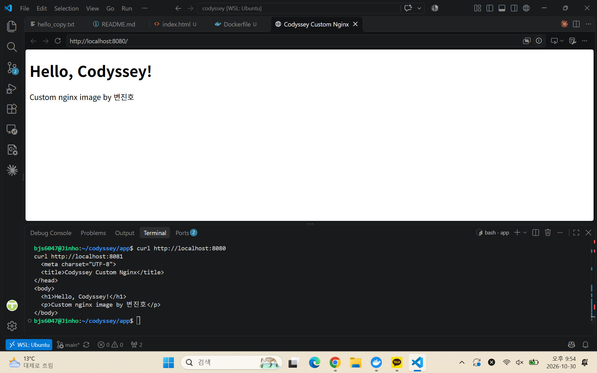
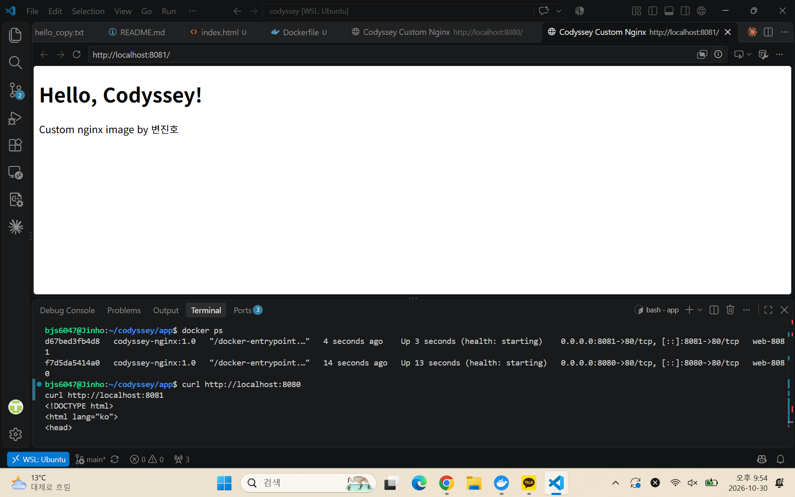

# jinho-Codyssey

# Codyssey: 개발 워크스테이션 구축

## 1. 프로젝트 개요

터미널(리눅스 CLI), Docker, Git/GitHub를 직접 설정하고 사용해 보며, 같은 환경을 누구나 재현할 수 있는 개발 워크스테이션을 구축하는 미션입니다. 모든 작업은 CLI 기반으로 수행했고, 실행한 명령과 출력 결과를 이 문서에 기록했습니다.

## 2. 실행 환경

| 항목 | 내용 |
|---|---|
| OS | Windows (버전 기입) + WSL2 Ubuntu |
| Shell / 터미널 | bash / VSCode 통합 터미널 (WSL 연결) |
| Docker | Docker Desktop (WSL2 백엔드), Docker version 29.7.2 |
| Git | git version 2.43.0 |

과제 본문의 OrbStack은 macOS 전용이라 Windows에서는 사용할 수 없어, 같은 역할을 하는 Docker Desktop(WSL Integration)으로 대체했습니다. 작업 폴더는 WSL 리눅스 파일시스템(`/home/bjs6047/codyssey`)에 두었습니다.

## 3. 수행 체크리스트

- [x] 터미널 기본 조작
- [x] 권한 변경 실습
- [x] Docker 설치/점검
- [x] Docker 기본 운영 명령 (images, ps, logs, stats)
- [x] hello-world 실행
- [x] ubuntu 컨테이너 실행, attach/exec 차이 관찰
- [ ] Dockerfile 커스텀 이미지 빌드/실행
- [ ] 포트 매핑 접속
- [ ] 바인드 마운트 반영
- [ ] 볼륨 영속성
- [x] Git 설정
- [ ] VSCode GitHub 연동 (스크린샷)

## 4. 수행 로그 및 검증

모든 로그는 핵심 부분만 발췌했고, 생략한 부분은 `(중략)`으로 표시했습니다.

### 4-1. 터미널 기본 조작

현재 위치/숨김 파일 포함 목록 확인, 디렉토리 생성 및 이동, 빈 파일 생성, 내용 쓰기와 확인을 수행했습니다.

```bash
bjs6047@Jinho:~/codyssey$ pwd
/home/bjs6047/codyssey
bjs6047@Jinho:~/codyssey$ ls -la
total 12
drwxr-xr-x 3 bjs6047 bjs6047 4096 Oct 30 19:57 .
drwxr-x--- 8 bjs6047 bjs6047 4096 Oct 30 19:58 ..
drwxr-xr-x 7 bjs6047 bjs6047 4096 Oct 30 19:57 .git
bjs6047@Jinho:~/codyssey$ mkdir -p ~/codyssey/practice/docs
bjs6047@Jinho:~/codyssey$ cd ~/codyssey/practice
bjs6047@Jinho:~/codyssey/practice$ pwd
/home/bjs6047/codyssey/practice
bjs6047@Jinho:~/codyssey/practice$ touch empty.txt
bjs6047@Jinho:~/codyssey/practice$ echo "hello codyssey" > hello.txt
bjs6047@Jinho:~/codyssey/practice$ ls -la
total 16
drwxr-xr-x 3 bjs6047 bjs6047 4096 Oct 30 20:31 .
drwxr-xr-x 4 bjs6047 bjs6047 4096 Oct 30 20:11 ..
drwxr-xr-x 2 bjs6047 bjs6047 4096 Oct 30 20:11 docs
-rw-r--r-- 1 bjs6047 bjs6047    0 Oct 30 20:30 empty.txt
-rw-r--r-- 1 bjs6047 bjs6047   15 Oct 30 20:31 hello.txt
bjs6047@Jinho:~/codyssey/practice$ cat hello.txt
hello codyssey
```

`>`와 `>>`의 차이를 확인했습니다. `>`는 기존 내용을 덮어쓰고, `>>`는 파일 끝에 추가합니다.

```bash
bjs6047@Jinho:~/codyssey/practice$ echo "second line" > hello.txt
bjs6047@Jinho:~/codyssey/practice$ cat hello.txt
second line
bjs6047@Jinho:~/codyssey/practice$ echo "third line" >> hello.txt
bjs6047@Jinho:~/codyssey/practice$ cat hello.txt
second line
third line
```

복사, 이동, 이름 변경을 확인했습니다. 같은 `mv` 명령이라도 마지막 인자가 디렉토리면 이동, 존재하지 않는 이름이면 이름 변경으로 동작합니다.

```bash
bjs6047@Jinho:~/codyssey/practice$ cp hello.txt hello_copy.txt
bjs6047@Jinho:~/codyssey/practice$ ls -l
-rw-r--r-- 1 bjs6047 bjs6047    0 Oct 30 20:30 empty.txt
-rw-r--r-- 1 bjs6047 bjs6047   23 Oct 30 20:32 hello.txt
-rw-r--r-- 1 bjs6047 bjs6047   23 Oct 30 20:35 hello_copy.txt
(중략)
bjs6047@Jinho:~/codyssey/practice$ mv hello_copy.txt docs/
bjs6047@Jinho:~/codyssey/practice$ mv empty.txt blank.txt
bjs6047@Jinho:~/codyssey/practice$ ls -l
-rw-r--r-- 1 bjs6047 bjs6047    0 Oct 30 20:30 blank.txt
drwxr-xr-x 2 bjs6047 bjs6047 4096 Oct 30 20:36 docs
-rw-r--r-- 1 bjs6047 bjs6047   23 Oct 30 20:32 hello.txt
bjs6047@Jinho:~/codyssey/practice$ ls -l docs
-rw-r--r-- 1 bjs6047 bjs6047 23 Oct 30 20:35 hello_copy.txt
```

상대 경로 이동과 삭제를 확인했습니다. 디렉토리는 `-r` 옵션이 필요합니다.

```bash
bjs6047@Jinho:~/codyssey/practice$ cd docs
bjs6047@Jinho:~/codyssey/practice/docs$ pwd
/home/bjs6047/codyssey/practice/docs
bjs6047@Jinho:~/codyssey/practice/docs$ cd ..
bjs6047@Jinho:~/codyssey/practice$ pwd
/home/bjs6047/codyssey/practice
bjs6047@Jinho:~/codyssey/practice$ rm blank.txt
bjs6047@Jinho:~/codyssey/practice$ rm -r docs
bjs6047@Jinho:~/codyssey/practice$ ls -la
total 12
drwxr-xr-x 2 bjs6047 bjs6047 4096 Oct 30 20:42 .
drwxr-xr-x 4 bjs6047 bjs6047 4096 Oct 30 20:11 ..
-rw-r--r-- 1 bjs6047 bjs6047   23 Oct 30 20:32 hello.txt
```

### 4-2. 권한 실습

파일(`hello.txt`)과 디렉토리(`permdir`) 각각에 `chmod`를 적용해 변경 전/후를 비교했습니다.

```bash
# 파일: 644 -> 600 -> 644
bjs6047@Jinho:~/codyssey/practice$ ls -l hello.txt
-rw-r--r-- 1 bjs6047 bjs6047 23 Oct 30 20:32 hello.txt
bjs6047@Jinho:~/codyssey/practice$ chmod 600 hello.txt
bjs6047@Jinho:~/codyssey/practice$ ls -l hello.txt
-rw------- 1 bjs6047 bjs6047 23 Oct 30 20:32 hello.txt
bjs6047@Jinho:~/codyssey/practice$ chmod 644 hello.txt
bjs6047@Jinho:~/codyssey/practice$ ls -l hello.txt
-rw-r--r-- 1 bjs6047 bjs6047 23 Oct 30 20:32 hello.txt

# 디렉토리: 755 -> 600 -> 755
bjs6047@Jinho:~/codyssey/practice$ mkdir permdir
bjs6047@Jinho:~/codyssey/practice$ ls -ld permdir
drwxr-xr-x 2 bjs6047 bjs6047 4096 Oct 30 20:48 permdir
bjs6047@Jinho:~/codyssey/practice$ chmod 600 permdir
bjs6047@Jinho:~/codyssey/practice$ ls -ld permdir
drw------- 2 bjs6047 bjs6047 4096 Oct 30 20:48 permdir
bjs6047@Jinho:~/codyssey/practice$ cd permdir
bash: cd: permdir: Permission denied
bjs6047@Jinho:~/codyssey/practice$ chmod 755 permdir
bjs6047@Jinho:~/codyssey/practice$ ls -ld permdir
drwxr-xr-x 2 bjs6047 bjs6047 4096 Oct 30 20:48 permdir
bjs6047@Jinho:~/codyssey/practice$ cd permdir
bjs6047@Jinho:~/codyssey/practice/permdir$ pwd
/home/bjs6047/codyssey/practice/permdir
```

소유자에게 `r`, `w`가 있는데도 디렉토리의 `x`가 없으면 `cd`가 실패했습니다. 디렉토리의 `x`는 "그 안으로 들어가거나 안의 항목에 접근할 수 있는 권한"을 뜻합니다.

### 4-3. Git 설정

기본 브랜치를 `main`으로 설정하고 사용자 정보를 등록했습니다.

```bash
bjs6047@Jinho:~/codyssey$ git config --global init.defaultBranch main
bjs6047@Jinho:~/codyssey$ git branch -m main
bjs6047@Jinho:~/codyssey$ git config --global user.name "Zino03"
bjs6047@Jinho:~/codyssey$ git config --global user.email "z***@naver.com"
bjs6047@Jinho:~/codyssey$ git config --list
user.name=Zino03
user.email=z***@naver.com
init.defaultbranch=main
core.repositoryformatversion=0
core.filemode=true
core.bare=false
core.logallrefupdates=true
```

(이메일은 일부 마스킹했습니다.)

GitHub 인증 상태입니다. 토큰은 마스킹되어 표시됩니다.

```bash
bjs6047@Jinho:~/codyssey$ gh auth status
github.com
  ✓ Logged in to github.com account Zino03 (/home/bjs6047/.config/gh/hosts.yml)
  - Active account: true
  - Git operations protocol: https
  - Token: gho_************************************
```

VSCode GitHub 로그인 및 저장소 연동 스크린샷:

(여기에 스크린샷 삽입: `docs/images/github-login.png`)

### 4-4. Docker 설치 및 점검

```bash
bjs6047@Jinho:~/codyssey$ docker --version
Docker version 29.7.2, build a7dcaa6
bjs6047@Jinho:~/codyssey$ docker info
Client:
 Version:    29.7.2
 Context:    default
 (플러그인 목록 중략)

Server:
 Containers: 2
  Running: 0
  Paused: 0
  Stopped: 2
 Images: 1
 Server Version: 29.7.2
 Storage Driver: overlayfs
 Logging Driver: json-file
 Cgroup Driver: cgroupfs
 Cgroup Version: 2
 Kernel Version: 6.6.87.2-microsoft-standard-WSL2
 Operating System: Docker Desktop
 OSType: linux
 Architecture: x86_64
 CPUs: 16
 Total Memory: 7.608GiB
 (이하 중략)
```

클라이언트와 서버 버전이 같고, 커널이 `microsoft-standard-WSL2`로 표시되어 WSL2 백엔드로 동작함을 확인했습니다. 서버 정보에 보이는 기존 컨테이너 2개와 이미지 1개(mysql:8.4)는 다른 프로젝트에서 만든 것입니다.

### 4-5. Docker 기본 운영 명령

```bash
bjs6047@Jinho:~/codyssey$ docker pull nginx:alpine
alpine: Pulling from library/nginx
(레이어 다운로드 중략)
Status: Downloaded newer image for nginx:alpine
docker.io/library/nginx:alpine
bjs6047@Jinho:~/codyssey$ docker images
IMAGE          ID             DISK USAGE   CONTENT SIZE   EXTRA
mysql:8.4      b3b90af2a655       1.12GB          255MB    U
nginx:alpine   785835ea65db       94.5MB         27.2MB
bjs6047@Jinho:~/codyssey$ docker ps -a
CONTAINER ID   IMAGE       COMMAND                  CREATED        STATUS                    NAMES
f6dde900b527   mysql:8.4   "docker-entrypoint.s…"   2 months ago   Exited (137) 2 months ago ieobom-mysql
afa82ca3616a   mysql:8.4   "docker-entrypoint.s…"   2 months ago   Exited (0) 2 months ago   ieobom-mysql-check
bjs6047@Jinho:~/codyssey$ docker stats --no-stream
(실행 중인 컨테이너가 없어 출력 없음)
```

`logs`와 `stats`는 컨테이너를 실행한 뒤 4-6에서 함께 기록했습니다.

### 4-6. 컨테이너 실행 실습

**hello-world**

로컬에 이미지가 없으면 `docker run`이 자동으로 pull한 뒤 실행합니다.

```bash
bjs6047@Jinho:~/codyssey$ docker run hello-world
Unable to find image 'hello-world:latest' locally
latest: Pulling from library/hello-world
Status: Downloaded newer image for hello-world:latest

Hello from Docker!
This message shows that your installation appears to be working correctly.
(이하 중략)
bjs6047@Jinho:~/codyssey$ docker ps -a
CONTAINER ID   IMAGE         COMMAND    CREATED         STATUS                     NAMES
6f9769bf5e1b   hello-world   "/hello"   4 seconds ago   Exited (0) 4 seconds ago   romantic_lumiere
(이하 생략)
```

hello-world 컨테이너는 메시지를 출력하고 프로세스(`/hello`)가 끝나 `Exited (0)`으로 종료됩니다.

**ubuntu 컨테이너 진입**

```bash
bjs6047@Jinho:~/codyssey$ docker run -it --name ubuntu-test ubuntu bash
root@15a0440ff73d:/# ls
bin   dev  home  lib64  mnt  proc  run   srv  tmp  var
boot  etc  lib   media  opt  root  sbin  sys  usr
root@15a0440ff73d:/# echo "hello from container"
hello from container
root@15a0440ff73d:/# cat /etc/os-release
PRETTY_NAME="Ubuntu 26.04.1 LTS"
(중략)
root@15a0440ff73d:/# exit
bjs6047@Jinho:~/codyssey$ docker ps
CONTAINER ID   IMAGE     COMMAND   CREATED   STATUS    PORTS     NAMES
bjs6047@Jinho:~/codyssey$ docker ps -a
CONTAINER ID   IMAGE         COMMAND   CREATED              STATUS                     NAMES
15a0440ff73d   ubuntu        "bash"    About a minute ago   Exited (0) 11 seconds ago  ubuntu-test
(이하 생략)
```

컨테이너 안은 호스트(WSL Ubuntu)와 별개의 Ubuntu 26.04 환경이었습니다. `exit` 후 `docker ps`에는 보이지 않고 `docker ps -a`에만 남았습니다.

**exec 비교, logs, stats**

```bash
bjs6047@Jinho:~/codyssey$ docker run -d --name ubuntu-bg ubuntu sleep infinity
3a07402adf3ea9804ec4da1f0c02506c6f37542cd791c06ec3f01bd772d57a38
bjs6047@Jinho:~/codyssey$ docker exec -it ubuntu-bg bash
root@3a07402adf3e:/# echo "exec session"
exec session
root@3a07402adf3e:/# exit
bjs6047@Jinho:~/codyssey$ docker ps
CONTAINER ID   IMAGE     COMMAND            CREATED          STATUS          NAMES
3a07402adf3e   ubuntu    "sleep infinity"   20 seconds ago   Up 19 seconds   ubuntu-bg
bjs6047@Jinho:~/codyssey$ docker logs ubuntu-bg
(출력 없음)
bjs6047@Jinho:~/codyssey$ docker stats --no-stream
CONTAINER ID   NAME        CPU %     MEM USAGE / LIMIT     MEM %     NET I/O         BLOCK I/O       PIDS
3a07402adf3e   ubuntu-bg   0.00%     1.617MiB / 7.608GiB   0.02%     1.17kB / 126B   471kB / 4.1kB   1
```

**run -it와 exec -it의 차이 정리**

| 방식 | 명령 | `exit` 후 | 이유 |
|---|---|---|---|
| run -it | `docker run -it ubuntu bash` | 컨테이너 종료 | 내가 연 bash가 PID 1이라 끝나면 컨테이너도 끝남 |
| exec -it | `docker exec -it ubuntu-bg bash` | 컨테이너 유지 | PID 1은 `sleep infinity`이고 bash는 추가 프로세스 |

컨테이너는 PID 1 프로세스가 살아 있는 동안만 실행됩니다. `docker logs ubuntu-bg`가 비어 있는 것은 PID 1(`sleep`)이 출력을 내지 않기 때문입니다.

### 4-7. 커스텀 이미지 및 포트 매핑

**선택한 방식**: (A) 웹 서버 베이스 이미지 활용. `nginx:alpine`을 베이스로 정적 페이지만 교체했습니다.

**Dockerfile 커스텀 포인트**

| 명령 | 목적 |
|---|---|
| `FROM nginx:alpine` | 가볍고 검증된 웹 서버 이미지를 베이스로 사용 |
| `LABEL` | 이미지 제목/작성자를 메타데이터로 기록 |
| `ENV APP_ENV=dev` | 실행 환경을 코드와 분리해 환경 변수로 주입 |
| `COPY site/ ...` | 기본 nginx 페이지를 내 HTML로 교체 |
| `EXPOSE 80` | 컨테이너가 80번 포트를 사용함을 문서화 |
| `HEALTHCHECK` | 서버가 실제로 응답하는지 주기적으로 점검 |

(Dockerfile 전체를 코드블록으로 첨부)

**빌드 및 실행**

(docker build 핵심 출력, docker images, docker run 2회, docker ps 붙여넣기)

**포트 매핑 접속 증거**: 같은 이미지를 호스트 포트만 달리해 2회 실행했습니다 (`-p 8080:80`, `-p 8081:80`).




**LABEL 반영 확인**: `docker inspect`로 확인했고, 베이스 이미지의 `maintainer` 라벨은 상속되었습니다.

## 5. 트러블슈팅

### 5-1. `git push` 시 비밀번호 인증 거부

| 항목 | 내용 |
|---|---|
| 문제 | `remote: Invalid username or token. Password authentication is not supported for Git operations.` |
| 원인 가설 | GitHub는 HTTPS Git 작업에 계정 비밀번호를 받지 않으며, 터미널 push는 VSCode 로그인 정보를 사용하지 않음 |
| 확인 | 에러 메시지 확인, 원격 주소 자체는 정상 |
| 해결 | GitHub CLI 설치 후 `gh auth login`(브라우저 인증)으로 로그인, `gh auth status`로 확인 후 push |

### 5-2. `git push` rejected (fetch first)

| 항목 | 내용 |
|---|---|
| 문제 | `! [rejected] main -> main (fetch first)` |
| 원인 가설 | GitHub에서 저장소 생성 시 README가 함께 만들어져, 원격에 로컬에 없는 커밋이 있음 |
| 확인 | `git fetch origin`, `git log --oneline origin/main`으로 원격에 `Initial commit`(README.md)만 있음을 확인. 로컬과 겹치는 파일이 없음 |
| 해결 | `git pull --rebase origin main`으로 합친 뒤 `git push -u origin main` (`--force`는 사용하지 않음) |

### 5-3. WSL에서 docker 명령을 찾을 수 없음

| 항목 | 내용 |
|---|---|
| 문제 | `The command 'docker' could not be found in this WSL 2 distro.` |
| 원인 가설 | Docker Desktop의 WSL Integration이 Ubuntu에 대해 꺼져 있음 |
| 확인 | 에러 메시지, Docker Desktop은 `Engine running` 상태 |
| 해결 | Docker Desktop Settings → Resources → WSL Integration에서 Ubuntu 활성화 후 Apply & Restart, 터미널 재시작. 이후 `docker --version` 정상 출력 |

### 5-4. docker.sock 연결 오류 (permission denied → no such file)

| 항목 | 내용 |
|---|---|
| 문제 | `docker info`의 Server 섹션에서 `permission denied while trying to connect to the docker API at unix:///var/run/docker.sock` |
| 원인 가설 | 사용자가 `docker` 그룹에 속해 있지 않아 소켓에 접근하지 못함 |
| 확인 | `ls -l /var/run/docker.sock`은 `srw-rw---- 1 root docker`, `groups` 출력에 `docker` 없음 |
| 해결 | `sudo usermod -aG docker $USER` 후 WSL 세션을 재시작해 그룹 적용 |

그룹 적용 후에는 에러가 `no such file or directory`로 바뀌어 소켓 파일이 일시적으로 없는 상태였습니다. Docker Desktop이 다시 기동된 뒤 소켓이 재생성되어(`srw-rw---- 1 root docker`) `docker info`가 정상 출력되었습니다.

## 6. 개념 정리

(본인 말로 정리해서 작성)

- 절대 경로와 상대 경로:
- 파일 권한(r/w/x)과 755, 644:
- 포트 매핑이 필요한 이유:
- Docker 볼륨:
- Git과 GitHub의 차이: